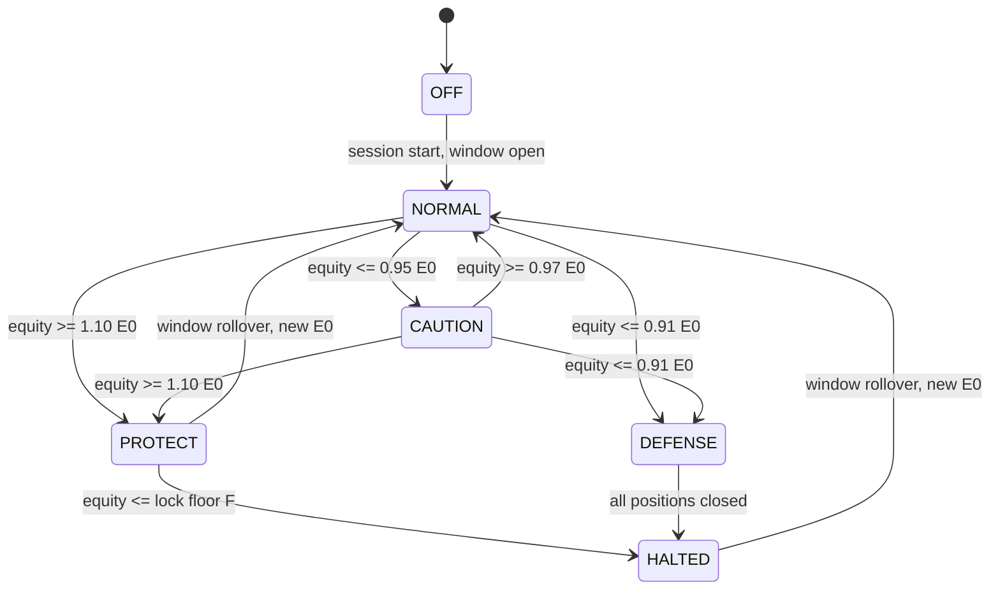
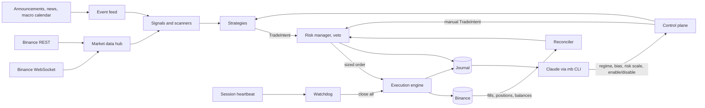

# TheMarketProject: Project Plan

Status: v0.6, 2026-10-22. Phases 0-3 are complete. The forward test on Demo Trading (Phase 4) runs with the event strategies. Live trading (Phase 5) started on 2026-10-22: the owner runs `delisting-short-4h`, started at risk scale 0.25, which proved too small: every entry would fall below Binance's 5 USDT minimum, so 0.3 is the floor at this account size. Goal revised: see section 1.

## 1. Goal and framing

TheMarketProject is a research experiment: an automated trading system on a Binance account (starting capital about 100 USDT), operated during interactive Claude Code sessions.

- **The bot** handles everything time-critical: market data, signal scanning, order execution, protective stops, and risk enforcement.
- **Claude** acts as portfolio manager during the session. It reads news, macro context, and market structure, chooses the market regime, enables and disables strategies, throttles risk, and proposes discretionary trades. Every Claude action goes through the bot's risk manager.

**Goal (revised 2026-10-22, with the owner's agreement).** Prove a durable positive edge with real money: positive expectancy after costs that live results confirm.

The original daily objective of +10% per 24-hour window, compounding (100 → 110 → 121 → …), is kept only as a window limit: profit locking at +10% and defense at −9%. The research (01–08) found no evidence that +10% a day is attainable. The best edges found make about 0.2% a day in-sample.

**Original daily objective.** Gain +10% equity per 24-hour window, compounding.

**Daily risk rules.**

- When the +10% target is reached, the bot switches to protect mode and locks in the gain.
- When the loss exceeds 9%, the bot switches to defense mode and stops further losses.

**Session rule.** The bot trades only while a Claude Code session is active. When the session ends, the bot closes all positions and cancels all orders.

**Research questions.**

1. How often is +10% per day reachable at all, given realistic volatility, fees, and slippage?
2. Which strategies have positive expectancy out-of-sample after costs?
3. Does Claude's discretionary overlay (news, regime, bias) add value over the bot alone?
4. How do the daily target and stop rules affect long-run growth?
5. What share of gross PnL goes to fees, slippage, and funding?

## 2. Reality check

This section exists so that the results of the experiment are read correctly.

| Consecutive +10% days | Equity (USDT) |
|---|---|
| 7 | 195 |
| 30 | 1,745 |
| 90 | ~531,000 |
| 365 | ~1.3 × 10^17 |

No known strategy sustains 10% per day. Top funds target 15–30% per **year**. The compounding ladder is an aspiration, not an expectation.

**The daily rules turn each day into a bet with two fixed outcomes.** If a day ends at either +10% or −9%:

- With a 50% chance of each outcome, two days give 1.10 × 0.91 = 1.001. That is zero growth before costs.
- Long-run growth is positive only if real edge pushes the win rate meaningfully above 50% after costs.
- If each day is a coin flip, the chance of 7 target days in a row is 0.8% at p = 0.5 and 2.8% at p = 0.6.

**Fees matter a lot at this scale.** Futures taker fees are about 0.05% per side.

- At 5x leverage, one taker round trip costs about 0.5% of equity.
- Ten such trades a day cost about 5% of equity, which is half the daily target.
- Therefore the bot uses maker (post-only) entries where possible and makes few, selective trades.

**The target needs leverage or very volatile assets.** BTC's typical daily range is 2–4%. A +10% day needs leverage, high-volatility altcoins, or an event-driven move, which all increase the variance of outcomes.

**What success looks like.** The experiment succeeds if it produces:

- a reliable, safe trading system;
- measured answers to the research questions;
- disciplined risk behavior, meaning no day ever breaches its loss line by more than slippage.

A profitable equity curve is a bonus, not the measure of success.

## 3. Boundaries

### Allowed

Anything inside the account: spot, margin, USDⓈ-M futures, Simple Earn, Convert, and transfers between wallets.

### Not allowed

- **Withdrawals.** The API key has no withdrawal permission, so funds cannot leave the account through the bot.
- **Market manipulation.** This covers pump groups, spoofing, layering, and wash trading. It is illegal in most jurisdictions, violates the Binance Terms of Service, and risks an account freeze.
- **Exploiting exchange bugs** or API inconsistencies.
- **Martingale sizing:** averaging down, or raising size to "catch up" after losses.
- **Orders that bypass the risk manager,** including orders from Claude.

### Practical constraints

- **Minimum order size.** Most spot and futures symbols have a minimum notional of 5 USDT. Futures majors are higher: as of 2026-10-21, the BTCUSDT perpetual requires 50 USDT and the ETHUSDT perpetual 20 USDT. With 100 USDT of capital, BTC and ETH perpetual positions are therefore coarse, and altcoin perpetuals are the practical venue. The bot always reads limits from `exchangeInfo` filters.
- **Fees (VIP0, verified on 2026-10-21).**
  - Spot: 0.10% maker and taker.
  - USDⓈ-M futures: 0.02% maker, 0.05% taker.
  - Paying fees in BNB gives a discount, and it is enabled for both spot and futures. The bot keeps a small BNB balance for fees and counts it in equity.
- **Latency.** The bot runs on a home PC with about 100–300 ms round trip, so strategies work on minute timeframes or slower. There is no high-frequency trading or market making.
- **Claude's reaction time** is minutes, so the bot handles everything that needs a response in seconds.
- **Jurisdiction.** Futures and margin availability depends on the account's country and on completing Binance's futures questionnaire.

### Publication

The repository is public. Everything except secrets is published.

**Published**

- the code;
- this plan;
- research notes and backtests;
- curated session and window reports, including losses.

**Never published**

- API keys, private keys, `.env`, and anything under `secrets/`;
- the account UID, whitelisted IP addresses, and listen keys;
- raw logs and state. These stay in `data/`, `logs/`, and `state/`, which git ignores; only curated reports go to `research/`.

**Safeguards.** GitHub secret scanning with push protection is enabled, and `.gitignore` covers all secret and runtime paths.

## 4. Risk framework

Risk is the core of the system and is built and tested first.

**Who may change the limits.** The rules below are enforced in code. At runtime, Claude can only tighten them, never loosen them. Loosening a limit requires a config change committed to git outside a live session.

### 4.1 Trading window ledger

- A 24-hour **window** opens at the first session start when no window is active.
- **E0** is total account equity at window open, marked to market in USDT. It covers spot, funding, futures (wallet balance plus unrealized PnL), net margin, and Earn.
- **Target T** = 1.10 × E0. **Loss line D** = 0.91 × E0.
- The next window's E0 is the equity at that moment. There are no catch-up targets: after a −5% day, the next target is +10% of the new E0.
- If sessions cover only part of the day, the bot trades only during those hours, while the window stays 24 hours long.

### 4.2 Risk modes



From any state, a session end goes to OFF: the bot closes all positions, cancels all orders, and writes a report.

| Mode | Trigger | Behavior |
|---|---|---|
| NORMAL | default | Full risk budget. |
| CAUTION | equity ≤ 0.95 × E0 | New trades at 50% size and only top-grade signals; at most 1 position open. |
| PROTECT | equity ≥ 1.10 × E0 | All stops move so the worst case stays at or above the lock floor F. New trades may risk only the cushion above F, at 50% size. |
| DEFENSE | equity ≤ 0.91 × E0 | Close all positions, cancel all orders, then go to HALTED. |
| HALTED | after DEFENSE, or when the PROTECT floor is hit | No new positions until the window rolls over. Idle USDT may go to Simple Earn Flexible. |

**Lock floor:** F = max(1.09 × E0, E0 + 0.7 × (peak − E0)). F only ratchets up. It locks at least +9% and 70% of any gain beyond the target.

### 4.3 Open-risk budget

This invariant makes the −9% line nearly a hard guarantee.

**Risk of one open position i:**

- risk_i = |mark − stop_i| × qty_i + estimated exit fee + slippage buffer
- It is measured from the mark price, not the entry price, because it is the drop in current equity if that stop fires.

**Pre-trade invariant:** equity_now − Σ risk_i (including the new trade) ≥ floor.

- In NORMAL and CAUTION mode, floor = D + buffer.
- In PROTECT mode, floor = F.

**Consequences.**

- If every stop fires at once, equity stays above the floor; only gaps or slippage beyond the buffer can push it below.
- As equity approaches D, the available budget shrinks to zero automatically, so the bot cannot take on more risk than the loss line allows.

### 4.4 Per-trade and portfolio limits

These are the initial values; all are in [`config/risk.toml`](../config/risk.toml).

**Sizing**

- **Risk per trade:** at most 3% of E0. This is multiplied by the mode multiplier and by Claude's risk scale (0 to 1).
- **Open positions:** at most 3. At most 2 may be in the same direction within the BTC-beta bucket (correlated altcoins).
- **Leverage:** 5x effective in normal operation (notional ÷ equity), 10x hard cap. The exchange leverage setting per symbol is at most 10x, with isolated margin.
- **Liquidation distance:** at least 2 × the stop distance from entry.

**Protective stops**

- Every position gets an exchange-side stop immediately after the entry fill: a reduce-only STOP_MARKET for the position's quantity. Binance allows only one close-position stop per direction, and that would rule out placing the new stop before cancelling the old one.
- If the stop cannot be placed, the bot closes the position at once.

**Trading rules**

- **No averaging down.** Adding to a position is allowed only while it is in profit and after the stop has moved to breakeven.
- **Fee control:** at most 12 round trips per window.
- **Funding:** do not hold through a funding timestamp when the rate against the position exceeds a threshold. The default threshold is 0.05%.

### 4.5 Project-level circuit breakers

| Condition | Action |
|---|---|
| Equity < 70% of starting equity | Pause the experiment and run a full review before resuming. Starting equity is the total account equity at the first live window. On 2026-10-21 that was about 123 USDT: 100 USDT plus BNB for fees and small altcoin balances. |
| 3 consecutive DEFENSE windows | Cut base risk per trade to 1.5% for the next 3 windows. |
| Bot state differs from exchange state | Block new entries until reconciled. |
| Market data stale for more than 60 s, or repeated API errors | Block new entries. Exchange-side stops stay in place. |

### 4.6 Session lifecycle and dead-man switch

**Normal operation**

- The bot runs as a **detached process**, so it survives the end of the session and can clean up after it.
- The Claude Code session starts a small **heartbeat process** as its own child, so it dies with the session. It touches a heartbeat file every 15 s.

**Ending the session**

- **Heartbeat stale for more than 120 s:** the bot enters SESSION_LOST. It closes all positions, cancels all orders, writes a report, and exits.
- **Normal end:** `mb session stop` runs the same shutdown.

**Defense in depth**

- Every position has an exchange-side stop, so if the bot process itself dies, the loss on each position is still bounded.
- The PC must not sleep during a session.

**Verified in Phase 2 (2026-10-22, Windows 11).**

- Stopping a Claude Code background task kills its whole process tree. Claude Code finds the tree through parent links, not through a Windows job object.
- A process that is merely detached dies with the tree. So `mb session start` launches the bot through an intermediate process that exits at once. The bot then has no living ancestor in the tree and survives to clean up.
- The heartbeat process is `mb session start` itself. It runs as a Claude Code background task and stops when that task is stopped.
- It also stops when any of its session ancestors exits, which covers Claude Code closing without stopping the task. The ancestors are the shell, `claude.exe`, and VS Code.

## 5. Instruments

| Instrument | Role | Notes |
|---|---|---|
| USDⓈ-M perpetual futures | Primary | Leverage, shorting, lower fees, funding and open-interest data. One-way mode, isolated margin. |
| Spot | Secondary | Long trades in coins without perpetuals, BNB for fee discounts, hedge leg for funding carry. |
| Margin (isolated) | Rare | Shorting coins that have no perpetual. Borrow cost applies. |
| Simple Earn Flexible | Parking | Idle USDT in HALTED mode and between sessions. Instant redemption. |
| Options | Out of scope for the MVP | Contract sizes and liquidity are poor at 100 USDT. Revisit later. |

**API notes to verify in Phase 0.**

- Binance has been changing how conditional orders (stop and take-profit) work on the futures API. Confirm the current endpoints and order types before building on them.
- Respect the rate-limit weights reported in response headers.

## 6. Information sources

### Market data (Binance, free)

- **Live streams:** klines, trades, order-book depth, 24h tickers, mark price, and funding.
- **Futures statistics:** open interest and its history, long/short ratios, taker buy/sell volume.
- **Liquidations:** the forced-order stream.
- **History:** bulk data from `data.binance.vision` (klines, aggregated trades, funding, metrics).

### Events and news

| Source | Use | Cost |
|---|---|---|
| Binance announcements (new listings, delistings, futures launches, Launchpool and HODLer airdrops, Monitoring tag) | Event strategy S3, highest priority | Free |
| News aggregators (CryptoPanic API) and RSS (CoinDesk, The Block, Cointelegraph, Decrypt) | Event feed, sentiment | Free tier |
| Macro calendar (CPI, FOMC, NFP, PCE) | Known volatility windows; risk throttle | Free |
| Fear & Greed index (alternative.me) | Regime context | Free |
| Token unlock schedules | Supply events, short bias | Free or scraped |
| Claude's web search during sessions (X, project blogs, exploit and hack reports) | Discretionary overlay | Part of the session |
| Coinglass, X API, Glassnode | Only if research shows value | Paid; the user approves |

## 7. Strategy portfolio

**Strategies are hypotheses.** Each one stays a hypothesis until a backtest and a forward test confirm it.

**Interface.** Every strategy emits a `TradeIntent`: symbol, side, entry type, stop, targets, rationale, and confidence. The risk manager sizes the trade or vetoes it.

**Path to +10% at 3% risk per trade.** The day needs about +3.3R net. For example, 3 winners at +2R against 2 losers at −1R gives +4R, or about +12%.

### S1. Momentum breakout on in-play perpetuals (core candidate)

- **Hypothesis.** Intraday momentum persists in coins with abnormal volume, open-interest growth, and volatility expansion.
- **Scanner.** Rank USDⓈ-M perpetuals by relative volume, ATR%, open-interest change, and taker buy/sell imbalance.
- **Entry.** A break of an opening range or a 15m Donchian channel, with volume confirmation and BTC regime agreement. Use a post-only entry where possible.
- **Exit.** The stop goes at the structure or ATR level. Take a partial at +2R, then trail with a chandelier or ATR stop.
- **Expected frequency:** 1–5 trades per day.

### S2. Liquidation-cascade fade

- **Hypothesis.** Forced liquidations overshoot fair price, so price partially retraces toward VWAP.
- **Signal.** The liquidation-volume z-score is extreme, and price deviates from VWAP by more than k × ATR.
- **Trade.** Take the opposite side with a tight stop beyond the cascade extreme. The target is a partial retrace to VWAP.
- **Expected frequency:** a few per week.

### S3. Event playbooks

**Hypothesis.** Scheduled and unscheduled events produce predictable volatility, and sometimes predictable direction.

| Event | Action |
|---|---|
| Binance spot listing for a coin that already has a perpetual | Long bias |
| Delisting announcement | Short the perpetual if it stays listed and liquid |
| New futures launch | Volatility setups |
| Macro release | Reduce risk before the release; trade the post-release breakout with S1 rules |

**Execution.** The bot detects events automatically. Claude approves each trade unless its playbook is fully specified and has been backtested on past announcements.

### S4. Funding carry and idle yield (defensive)

- **Hypothesis.** Extreme positive funding pays a delta-neutral position: long spot and short perpetual.
- **Use.** Small but positive returns, which suits PROTECT and HALTED modes.
- **Constraint.** Minimum order sizes make the legs coarse at 100 USDT.
- **Fallback.** Simple Earn Flexible.

### S5. Claude's discretionary overlay

**Inputs:** news, macro context, sentiment, and cross-asset context.

**Outputs:**

- the market regime (trend, range, high volatility, or event);
- a directional bias for each asset or bucket;
- which strategies are enabled;
- a risk scale from 0 to 1;
- manual `TradeIntent`s, which go through the same risk checks.

**Evaluation.** A shadow copy of the bot runs without the overlay and logs its hypothetical trades, so the overlay's added value can be measured (research question 3).

### Rejected approaches

| Approach | Reason |
|---|---|
| Market making and high-frequency scalping | Latency and competition. |
| Triangular arbitrage | Arbitraged away; latency-bound. |
| Pump groups | Market manipulation; account ban risk. |
| Martingale and grid averaging in trends | Ruin risk; violates the risk rules. |
| Copy trading | Not controllable through the API; no research value. |

## 8. Architecture



### Principles

- **Deterministic core.** The bot works without Claude; Claude steers it.
- **Single path to the exchange.** Every order passes through the risk manager. Claude never calls the trading API directly; there is an emergency `mb flatten` command for that.
- **The exchange is the source of truth.** The reconciler runs continuously; on startup the bot rebuilds its state from the exchange.
- **Everything is journaled.** This includes signals, intents, vetoes and their reasons, orders, fills, mode changes, and Claude's decisions with their rationale.

### Tech stack

| Area | Choice |
|---|---|
| Language and packaging | Python 3.12+, `uv`, `pyproject.toml` |
| Exchange access | Own thin async client: `httpx` for REST, `websockets` for streams. It signs with Ed25519 or HMAC. There is no abstraction layer between the risk manager and the exchange, which gives full control over Binance-specific endpoints and over order types that change over time. |
| Data | `polars`; indicators implemented in-house (EMA, ATR, RSI, VWAP, Bollinger, ADX, Donchian) to avoid TA-Lib build issues on Windows |
| Storage | SQLite (state, orders, journal); Parquet (market data, research) |
| Configuration | `pydantic-settings`; `.env` for keys (in `.gitignore`); TOML for risk and strategy settings (`tomllib`, no extra dependency) |
| Logging | `structlog` JSON lines |
| Tests | `pytest`, plus `hypothesis` for the invariants of the risk state machine |
| Alerts (optional) | Telegram bot to the user's phone, including a remote `/stop` command |

### Repository layout

```
TheMarketProject/
  pyproject.toml
  .env.example
  config/            risk.toml, strategies.toml
  src/marketbot/
    exchange/        Binance adapter, rate limits, symbol filters, reconciler
    data/            live collectors, history loader, storage
    signals/         indicators, scanners, announcement/news/macro feeds
    strategies/      S1..S5 -> TradeIntent
    risk/            window ledger, mode state machine, pre-trade checks
    execution/       entries, brackets, trailing stops, close-all
    control/         `mb` CLI, heartbeat, watchdog
    journal/         event log, trade journal, reports
    backtest/        event-driven backtester, cost model, Monte Carlo
  research/          analysis scripts and findings (markdown)
  tests/
  docs/
```

### Control CLI (Claude's interface to the bot)

| Command | Purpose |
|---|---|
| `mb run` | Start the bot as a detached process. |
| `mb session start` / `mb session stop` | Open or close a session (heartbeat, close-all on stop). |
| `mb status` | Show equity, E0, mode, floors, positions, open risk, and recent events. |
| `mb regime <trend\|range\|highvol\|event>`, `mb bias <symbol\|bucket> <long\|short\|neutral>` | Set context for the strategies. |
| `mb strategy enable\|disable <id>`, `mb risk-scale <0..1>` | Steer the strategy mix and risk. |
| `mb propose <symbol> <side> --stop <price> --target <price> --why "<text>"` | Submit a manual trade intent. |
| `mb pause` / `mb resume` / `mb flatten` | Stop new entries, resume, or close everything. |
| `mb report [--window <id>]` | Print the window or session report. |

## 9. Claude's session protocol

### Pre-session (about 10 minutes)

1. `mb status`: reconcile state and confirm the window, E0, and mode.
2. Check the macro calendar for the next 24 hours, crypto news, Binance announcements, and the Fear & Greed index.
3. Review the market: BTC and ETH structure, funding and open-interest extremes, the scanner's top in-play list.
4. Set the regime, the bias, the enabled strategies, and the risk scale, and record the rationale in the journal.

### In session

- **Self-paced loop** (`/loop`). Each tick refreshes the heartbeat, reads status and news, then adjusts the bot's settings or proposes trades.
- **Tick interval:** about 10–20 minutes normally, shorter around scheduled events.
- **Alerts.** A monitor on the bot's event log wakes Claude between ticks on fills, stop-outs, mode changes, vetoes, and errors.

### End of session

1. `mb session stop`: close all positions, cancel all orders, and park USDT.
2. Write the session report to the journal.
3. Update the research notes when something new was learned.

## 10. Phases

### Phase 0: Setup and safety

**The user:**

- Create an API key, Ed25519 preferred, with these permissions:
  - reading;
  - spot and margin trading;
  - futures;
  - margin loan and repay (optional);
  - universal transfer.
- Leave **withdrawals disabled** and **enable the IP whitelist**.
- Complete the futures questionnaire if needed.
- Put the keys in `.env` locally. Never paste them into chat.

**Claude:**

- Done: scaffold the repository, CI (ruff and pytest on Linux and Windows), `.gitignore`, `.env.example`.
- Done: `mb keygen`, which generates an Ed25519 key pair.
- Done: `mb check`, read-only checks of everything below. It fails if withdrawals are enabled or the key is not IP-restricted.
  - connectivity and clock offset;
  - symbol filters;
  - key permissions;
  - balances in all wallets;
  - fee rates;
  - futures position and asset modes;
  - BNB fee discount;
  - Simple Earn positions.
- To do: verify the current API details, namely conditional orders and the testnet and demo-trading endpoints.

**Gate:** `mb check` passes with the real key, and withdrawals are confirmed disabled. Passed on 2026-10-21.

### Phase 1: Exchange adapter, data, research baseline

- Build the exchange adapter (spot and futures), symbol filters, the rate limiter, and the reconciler.
- Build a historical downloader from `data.binance.vision` and live collectors for klines, tickers, funding, open interest, and liquidations.
- **Baseline research:**
  - the distribution of daily ranges and maximum favorable excursion for the top-volatility perpetuals;
  - how often +10% at leverage L is reachable;
  - the cost model;
  - a Monte Carlo simulation of the daily target and stop rules.

**Deliverable:** [`research/01-feasibility.md`](../research/01-feasibility.md). Completed on 2026-10-21. Without an edge, the window game loses in every universe and at every leverage. The +10% stays a cap, and Phase 3 targets asymmetric trades (1R risk, 2R+ reward) with low costs.

**Status of the remaining Phase 1 items.**

- **Done:** historical downloader and REST client.
- **Moved to Phase 2, where execution needs them:** the trading part of the exchange adapter, the reconciler, and the live collectors.

### Phase 2: Risk manager, execution, control plane

- **Risk manager:** window ledger, mode state machine, open-risk budget, limits, circuit breakers. Covered by unit tests and property-based tests.
- **Execution:** post-only entries with taker fallback, mandatory exchange-side stops, take-profits, trailing stops, close-all.
- **Control plane:** the `mb` CLI, heartbeat, watchdog, journal.
- **Drills on testnet:**
  - session loss (kill the heartbeat);
  - network loss;
  - bot crash with open positions;
  - a −9% breach;
  - reaching +10% (PROTECT floor behavior);
  - a stop that fails to place;
  - a reconciliation mismatch.

**Gate:** all drills pass, and the risk invariants are never violated in tests. Passed on 2026-10-22: [drill report](drills/2026-10-22-phase2-demo.md).

**Optional fast track.** After this gate, a first live "mechanics run" is possible at a 0.25 risk scale with Claude's discretionary trades only. Its purpose is to validate execution on mainnet, not to make a profit.

### Phase 3: Strategies and backtests

- Build an event-driven backtester with fees, slippage, funding, and minimum-notional rounding.
- Implement S1–S4, and backtest them walk-forward on out-of-sample periods.
- Backtest S3 against historical Binance announcements.
- **Promotion criteria for a strategy:**
  - positive expectancy after costs out-of-sample;
  - profit factor above 1.2 over at least 100 trades (S3: over at least 20 events);
  - no single trade accounting for most of the PnL.

**Deliverable:** `research/02-strategies.md` with results, including the strategies that failed.

**Status (2026-10-22).**

**Research done:**

- [02](../research/02-strategies.md): intraday technical rules have no edge in either year.
- [03](../research/03-listings.md): shorting busy new listings is positive in both years.
- [04](../research/04-delistings.md): shorting after delisting announcements is positive in both years and the strongest result.
- [05](../research/05-spot-listings.md): longs on spot listing announcements lose.
- [06](../research/06-funding.md): extreme funding has no consistent edge.
- [07](../research/07-monitoring-tag.md): shorting after the Monitoring Tag is positive in both years.
- [08](../research/08-portfolio.md): the event strategies together, as a portfolio. About ×3.7 in two years in-sample, which is about +0.2% a day.
- [09](../research/09-airdrops.md): listings whose tokens Binance airdrops (HODLer Airdrops, Launchpool, Megadrop) drift most; futures-only listings, nearly all of 2026, drift little. Shorting a listed perpetual after an airdrop announcement is positive, strongly so since 2025-10, on 32 events.
- [10](../research/10-upbit.md): after Upbit KRW listings the Binance perpetual fades, but funding on the crowded short takes most of it; no strategy. Funding in the live delisting and Monitoring Tag shorts is negligible (0.08% per trade).
- [11](../research/11-unlocks.md): shorting into scheduled insider unlocks earns about 1% over the same token's baseline, only in one year and not significant across tokens; no strategy.
- [12](../research/12-reversal.md): weekly cross-sectional reversal and momentum flip sign between years; no strategy.
- [13](../research/13-out-of-time.md): an out-of-time check of the event strategies on events after the research data ends, re-run with `mb research forward`. October 2026: the delisting short averaged +11.7% over 3 tradable events.
- [14](../research/14-exchanges.md): after Bybit or OKX delist their own perpetual of a token, the Binance perpetual drifts down for days: +4.4% per trade for a 7-day short with a 30% stop, positive in all 32 tested variants. Bybit and OKX listings and spot delistings: nothing stable.

**Promoted to the forward test:** `delisting-short-4h`, `monitoring-short-1d`, and `listing-short-busy-7d`; since research 09 and 14, also `airdrop-short-7d` and `exchange-delisting-short-7d` (Demo Trading only).

- **Delisting short** meets the criteria: 79 events, profit factor above 1.2, and positive in both years.
- **Listing short** has thinner t-statistics but a broad, consistent effect.

**How to go live:** [LIVE.md](LIVE.md).

**Decisions for the owner:**

- keeping multi-day positions between sessions (`MB_ON_STOP=keep`);
- the risk per trade for the event strategies.

### Phase 4: Forward test (runs alongside Phase 3)

- Run the promoted strategies on testnet or demo with live data. Testnet fills are not realistic, so this checks mechanics only.
- Run a mainnet shadow mode: real data, logged signals, no orders. This shows live expectancy.
- **Gate:** at least 5 session-days without risk-rule violations or reconciliation errors, and shadow results consistent with the backtest.

### Phase 5: Live ramp-up

- Raise the risk scale in steps: 0.3 → 0.5 → 1.0. Below about 0.3, entries with a 20% stop fall under Binance's 5 USDT minimum notional at this account size.
- Move to the next step only after at least 5 windows with no rule violations and with results within the expected range.
- The shadow bot without the overlay keeps running as a control group.

### Phase 6: Operate and iterate

- Run sessions according to the protocol.
- Hold a weekly review: strategy attribution, overlay value, fee share, adjustments to the rules.
- Retire strategies that decay, and add new hypotheses through Phase 3 again.

### Indicative timeline

| Milestone | Approximate timing |
|---|---|
| Phases 0–2 | 4–6 working days |
| Phases 3–4 | 1–2 weeks |
| Full risk scale (Phase 5) | 3–4 weeks from start, if the gates pass |

## 11. Metrics and reporting

**Per window**

- E0, close, peak, and trough equity
- The outcome: target, defense, or neither
- Number of trades, win rate, average R
- Fees, funding, and slippage
- Time spent in each mode

**Per strategy**

- Expectancy (R)
- Profit factor
- Maximum adverse excursion and maximum favorable excursion
- Hit rate
- Live results compared with the backtest

**Overlay value:** live PnL with the overlay compared with the shadow bot's hypothetical PnL.

**Project level**

- Equity curve and maximum drawdown
- Share of days that hit the target and share of days that hit defense
- Count of rule violations, which must be zero
- Breaches of the loss line beyond the slippage buffer

**Reports.** The bot generates a markdown report for each window and each session in `research/journal/`.

## 12. Costs outside the account

| Cost | Approach |
|---|---|
| Claude usage | Sessions run on a Claude Max 20x subscription, so there is no per-token cost; the constraint is the plan's usage limits. To stay within them: keep loop ticks sparse, wake Claude through event alerts instead of frequent polling, keep `mb status` output compact, and delegate routine news scans to subagents on smaller models. |
| Data APIs | Free tiers first. Any paid source needs the user's approval and evidence that it adds value. |

## 13. Decisions

| # | Decision | Current choice | Status |
|---|---|---|---|
| 1 | What happens at session end | Close all positions and cancel all orders. | Adopted as default |
| 2 | Window anchor | 24 hours from the first session start. | Adopted as default |
| 3 | Project-level stop | Pause and review when equity falls below 70% of starting equity. | Adopted as default |
| 4 | Availability of futures and margin | Available. The futures account is in one-way, single-asset mode. | Verified on 2026-10-21 |
| 5 | Remote control | Telegram alerts and a `/stop` command. | Optional, later |
| 6 | Repository | Public; MIT license; commits go directly to `main` with CI. | Adopted |
| 7 | IP restriction on the live key | None, by the owner's decision (dynamic IP). `ALLOW_UNRESTRICTED_IP=true` turns the `mb check` failure into a warning. Withdrawals stay disabled, and margin loans should be off on the key. The bot closes unknown positions and alerts. Binance deletes unrestricted trading keys after 30 days without orders. | Adopted 2026-10-22 |
